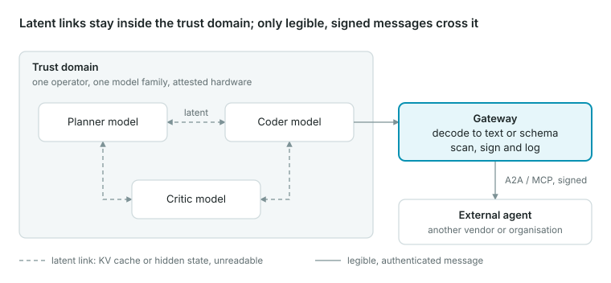

## The short answer

Two frozen, off-the-shelf language models connected by a raw socket will not spontaneously start exchanging binary. They emit tokens, because that is the only output they were trained to produce. The drift toward non-human encodings that research has documented happens under one of three conditions: the models are *trained* together with a reward that ignores human readability, they are *instructed or engineered* to switch, or the designers *wire their internals together* (hidden states, KV caches) on purpose.

So the real question behind "NoProtocol" is not whether models will invent binary on their own. It is whether we will let them, or build systems that make them, because the efficiency gains are real. That is a design choice with large security and safety consequences.

**What "NoProtocol" means here.** Today agent-to-agent traffic rides on explicit protocols such as MCP, Google's A2A and plain JSON-over-HTTP. Each defines message types, schemas, identity and a human-legible payload. A NoProtocol channel removes that layer: the two models agree on their own encoding, whether that is compressed shorthand, an ad-hoc binary format, an acoustic modem signal, or direct transfer of internal tensors. Nothing outside the two endpoints is guaranteed to understand what passed between them.

## What the evidence actually shows

Every well-known case of machines "leaving human language" falls into one of three buckets: drift under training pressure, scripted switching, or engineered latent exchange. None is a case of deployed LLMs inventing binary unprompted.

| Case | Year | What happened | Spontaneous? | Payload humans can read? |
| --- | --- | --- | --- | --- |
| [LatentMAS](https://arxiv.org/abs/2511.20639) (Princeton, Stanford, UIUC et al., ICML 2026) | 2025–26 | Agents reason in last-layer hidden states and hand each other KV-cache "working memory". Training-free. Up to 14.6% higher accuracy, 70.8–83.7% fewer output tokens, about 4x faster than text-based multi-agent baselines | No, engineered | No (tensors) |
| [Cache-to-Cache (C2C)](https://arxiv.org/abs/2510.03215) (Tsinghua, ICLR 2026) | 2025–26 | A learned fuser projects one model's KV cache into another's. 3.1–5.4% more accurate than text exchange, about 2.5x lower latency | No, engineered | No (tensors) |
| [DroidSpeak](https://www.usenix.org/conference/nsdi26/presentation/liu-yuhan) (UChicago, Microsoft, NSDI 2026) | 2024–26 | Fine-tuned variants of one base model reuse each other's KV caches, recomputing a few critical layers. Up to 4x throughput, ~3.1x faster prefill | No, engineered | No (tensors) |
| [Gibberlink](https://github.com/PennyroyalTea/gibberlink) (ElevenLabs hackathon) | 2025 | Two voice agents booking a hotel switch from English to the ggwave data-over-sound modem once each detects the other is an AI | No. The authors say the agents [were explicitly prompted](https://community.openai.com/t/gibberlink-more-efficient-ai-communications/1128907/18) to switch | Yes once decoded: the sound carries short text/JSON |
| [Agora](https://arxiv.org/abs/2410.11905) (Oxford et al.) | 2024 | LLM agents start in natural language, then negotiate a plain-text Protocol Document and write code routines for frequent exchanges. In a 100-agent network, task-specific protocols emerged | Partly: the format is negotiated, but the spec stays human-readable and hash-addressed | Yes |
| [Emergent communication](https://arxiv.org/abs/2006.02419) research (DeepMind, FAIR, others) | 2016– | Agents trained jointly with reinforcement learning develop their own codes; [Lazaridou et al.](https://arxiv.org/abs/2005.07064) catalogue structural, semantic and pragmatic "language drift" | Yes, under training | Often no |
| [FAIR "Deal or No Deal"](https://arxiv.org/abs/1706.05125) negotiation bots | 2017 | Bots fine-tuned against each other drifted into repetitive shorthand ("to me to me to me"); researchers re-anchored them to English because the goal was talking to people | Yes, under training | Barely: English words, broken grammar |

**The pattern.** Spontaneous drift appears only when a reward gradient flows through the communication channel and nothing penalises leaving human language. Latent exchange appears when engineers deliberately remove the text bottleneck for speed and accuracy. The viral "secret language" stories (FAIR in 2017, Gibberlink in 2025) were both less autonomous than the headlines suggested. FAIR's bots were redirected, [not "shut down out of fear"](https://www.elektormagazine.com/news/it-was-a-quiet-news-day-at-facebook), and Gibberlink was a scripted demo of a 1980s-style modem technique.

## Will they go binary?

Inside one operator's infrastructure, probably yes, and soon, because engineers will choose latent channels for 2–4x speedups. Across organisational trust boundaries, probably not, because heterogeneous models cannot share internals and identity, audit and liability all require a legible message.

**"Binary" is the wrong word.** Everything on a network is already binary. The meaningful distinctions are whether a message is *human-interpretable* and whether it is *discrete* (tokens from a vocabulary) or *continuous* (vectors of floats). A Gibberlink chirp is binary on the wire but decodes to plain text. A KV-cache transfer is also binary, but no human or standard parser can read it.

**Why the pull toward latent exchange is strong.** A sampled token from a ~100k-word vocabulary carries at most about 17 bits. A single hidden-state vector in a 4,096-dimensional model, at 16-bit precision, is about 65,000 bits of raw capacity (our arithmetic, not a measured information content). Text forces the sender to collapse a rich internal state into a thin stream, then forces the receiver to rebuild it. The C2C and LatentMAS results are what you would expect when that bottleneck is removed: better accuracy, far fewer generated tokens, lower latency.

**Three routes off human language, and what each needs:**

1. **Instructed encoding.** A developer tells agents to switch codecs (Gibberlink, base64, a compact binary schema). Needs only a prompt and a tool. The semantics stay textual, so a third party with the codec can still read everything.
2. **Learned drift.** Agents fine-tuned together against a shared reward slide into private shorthand. Needs a gradient flowing through the channel and no penalty for leaving natural language. As multi-agent reinforcement learning on outcome rewards becomes a standard post-training step, this pressure stops being academic.
3. **Engineered latent exchange.** Hidden states or KV caches pass directly between models. Needs compatible internals: DroidSpeak only works between fine-tunes sharing an architecture, C2C trains a projector per model pair, and LatentMAS assumes a shared working memory. This is the closest thing to a true "NoProtocol" link.

**The likely end state is layered, not protocol-free.** Expect latent links inside a trusted cluster (same vendor, same model family, same operator), wrapped in structured protocols such as A2A and MCP at every organisational boundary. Agora points at the middle path: agents may *negotiate* an efficient format, but the agreement is written down in a human-readable, hash-addressed document.

## The case for NoProtocol

The benefits are measurable and large: published systems report 2.5–4x lower latency, 70–84% fewer generated tokens and a few points of accuracy, with no new model training in the LatentMAS case.

- **Speed and cost.** Token-by-token decoding is the slowest part of inference. Skipping it between agents removes most of the wall-clock time in a multi-agent pipeline, and fewer tokens means lower GPU spend and energy.
- **Fidelity.** Text is lossy and ambiguous. C2C's authors point out that a receiving model can misread a cue the sender meant precisely; a cache transfer carries the sender's own interpretation rather than a paraphrase of it.
- **Better collective reasoning.** Accuracy gains over text-based multi-agent baselines (3–5 points for C2C, up to 4.6 for LatentMAS) suggest agents lose useful uncertainty and intermediate structure when forced to verbalise.
- **Reuse of shared context.** DroidSpeak shows that agents working on the same long context need not each re-read it; one prefill can serve several related models.
- **Robustness to phrasing attacks.** A channel that does not carry free text cannot be talked into anything by a cleverly worded message. This only holds if nothing upstream re-renders the latent as text, and it does not hold against adversaries who can craft tensors (see risks).
- **Edge and on-device fit.** Between co-located models on one device or one server, skipping the decode-then-re-encode round trip saves compute and battery. The saving is in compute, not network bytes: a KV cache is far larger than the text it encodes (see the risks).

## Security and safety risks

The central problem is an asymmetry: a latent channel is unreadable to defenders but not to capable attackers. Removing the protocol layer removes the places where today's security controls live, while the content itself stays recoverable by anyone with the right model.

**1. Oversight goes dark.** Guardrail classifiers, data-loss prevention, audit logs and human review all operate on text. A [41-author position paper](https://arxiv.org/abs/2507.11473) from researchers at OpenAI, Google DeepMind, Anthropic and others argued in July 2025 that readable chains of thought are a valuable but *fragile* safety signal that latent reasoning could erode. Latent inter-agent messages are the multi-agent version of the same loss: the conversation where agents plan together is no longer inspectable.

**2. A ready-made covert channel for collusion.** [Motwani et al. (NeurIPS 2024)](https://arxiv.org/abs/2402.07510) formalised "secret collusion": agents hiding coordination from overseers via steganography. They found steganographic ability rising with model capability and showed that defences such as paraphrasing are limited. In a text channel, colluding agents must hide signals inside plausible prose. In a latent channel they need not hide anything, because the whole channel is opaque by default. In classic security terms, NoProtocol hands every agent pair an unmonitored covert channel.

**3. Faster, invisible worm propagation.** [Prompt Infection (Lee and Tiwari, 2024)](https://arxiv.org/abs/2410.07283) showed malicious instructions self-replicating from agent to agent, stealing data as they spread, even when agents do not share all messages. Its proposed defence, tagging which text came from another LLM, depends on being able to see and mark text. A poisoned KV cache or hidden state passed downstream cannot be scanned, tagged or quarantined with today's tools.

**4. A much larger attack surface: adversarial tensors.** A text interface accepts only vocabulary tokens. A latent interface accepts any vector. [Schwinn et al. (NeurIPS 2024)](https://arxiv.org/abs/2402.09063) found that attacks in continuous embedding space strip safety alignment more efficiently than text jailbreaks or fine-tuning. Any agent that accepts latents from a peer accepts this threat model from that peer, and from anyone who compromises it.

**5. Opaque is not private.** Latents look like noise to a human auditor but leak content to an attacker. [Vec2Text](https://arxiv.org/abs/2310.06816) recovered 92% of 32-token inputs exactly from their embeddings, and the authors concluded embeddings deserve the same protection as raw text. Shared KV caches have already produced side channels: [PromptPeek (NDSS 2025)](https://www.ndss-symposium.org/ndss-paper/i-know-what-you-asked-prompt-leakage-via-kv-cache-sharing-in-multi-tenant-llm-serving/) reconstructs other tenants' prompts, and a [timing attack](https://arxiv.org/abs/2409.20002) recovered system prompts token by token from cache hits.

**6. No identity, integrity or accountability.** Protocols carry sender identity, signatures, schemas, versions and replay protection. A raw latent stream carries none of these, so "who told this agent to do that?" becomes unanswerable, which breaks forensics and non-repudiation. Gibberlink-style mode switches are triggered by an *unauthenticated* belief that "the other side is an AI", which any attacker can fake.

**7. Silent semantic failure.** Text and schemas fail loudly with parse errors. Latents fail quietly: [DroidSpeak](https://www.usenix.org/conference/nsdi26/presentation/liu-yuhan) found that naively sharing caches between differing models degrades quality sharply. A routine model update on one side can corrupt meaning on the other with no error raised.

**8. Drift you cannot see even in text.** [Lazaridou et al.](https://arxiv.org/abs/2005.07064) describe *pragmatic drift*: co-adapted agents can keep using English words while meaning something different from what a human reader infers. Co-trained agents can therefore develop a private dialect even inside a protocol that looks human-readable.

**9. Bandwidth and the network itself.** A KV cache is enormous next to text. For an 8B-parameter model with grouped-query attention (32 layers, 1,024 KV dimensions, 16-bit), one token's cache is about 128 KB versus a few bytes of text (our arithmetic). Across a WAN this is impractical and expands what an eavesdropper can harvest, which keeps true NoProtocol links inside datacentres and on-device for now.

## Pros and cons at a glance

Each step away from human-readable text buys speed and fidelity and pays for it in oversight. The rows run from most to least legible.

| Mode | Example | Main gain | Human-auditable | Works across vendors | Main risk |
| --- | --- | --- | --- | --- | --- |
| Natural language | Agents chatting in English | Universal, flexible, easy to debug | Yes | Yes | Prompt injection, ambiguity, slow token decoding |
| Structured protocol | A2A, MCP, JSON over HTTPS | Typed messages, identity, schemas, tooling | Yes | Yes | Rigid; needs human design and versioning |
| Negotiated protocol | Agora Protocol Documents | Efficiency of a protocol without hand-writing one | Yes, if specs are logged | Yes | Agents may agree on formats nobody reviews |
| Encoded tokens | Gibberlink over ggwave, base64, private shorthand | Compact, fast on a narrow channel | Only with the codec; drifted shorthand barely | Partly | Unauthenticated mode switch; covert shorthand |
| Latent exchange | C2C, LatentMAS, DroidSpeak | 2.5–4x lower latency, a few points more accuracy | No | No: same family or a trained adapter | Monitoring blind spot, collusion, adversarial tensors, inversion leaks, huge payloads |

## Getting the speed without losing oversight

The workable design is "latent inside, legible at the edges": allow protocol-free links only within one trust domain, and force everything that crosses a boundary back into an authenticated, inspectable protocol.

<figure>
  
  <figcaption>Latent traffic stays among co-located models; the gateway is the only way out, and it emits legible, signed messages.</figcaption>
</figure>

1. **Bound the latent zone.** Permit KV-cache or hidden-state exchange only between models run by the same operator, from the same model family, on attested hardware. Never across tenants or organisations.
2. **Decode at the gate.** Any result leaving the latent zone is rendered to text or a typed schema, scanned and logged before it crosses. The gateway is where guardrails, DLP and human review keep working.
3. **Treat latents as raw data.** Encrypt them in transit and at rest, isolate KV caches per tenant, and set retention limits. Embedding inversion and cache side channels mean "unreadable" offers no confidentiality.
4. **Authenticate any mode switch.** Moving from text to a compact encoding should be a signed capability exchange (for example via A2A agent cards), never inferred from "the other side sounds like a bot".
5. **Fail loudly.** Stamp every latent message with the sender's model and version hash, reject mismatches, and check incoming tensors against expected norms and distributions before they reach the model.
6. **Keep a legible shadow.** Log the negotiated format (an Agora-style, hash-addressed protocol document) and a text summary of each latent session so forensics can reconstruct who asked for what.
7. **Anchor co-trained agents to language.** When agents are fine-tuned together, add a penalty for drifting from a frozen reference language model, and measure drift and steganographic capacity (for example with Motwani et al.'s CASE evaluations) at each training checkpoint.
8. **Red-team the channel, not just the model.** Test for collusion, self-replicating injection and embedding-space attacks between agents before deployment.
9. **Make monitorability a release criterion.** Following the chain-of-thought monitorability authors, weigh any efficiency gain against what it does to your ability to see what the system is doing, and record that decision.

Open research question: reliable *latent auditors* that translate hidden-state traffic into faithful text summaries. Until they exist, recommendation 2 is the only robust control.

## Conclusion

AI models will not drift into binary simply because nobody imposed a protocol. They will leave human language when we train them to or wire them to, and the efficiency numbers guarantee that someone will. The research record so far is mostly engineering (C2C, LatentMAS, DroidSpeak) and a few overstated viral moments (FAIR 2017, Gibberlink 2025), not autonomous invention.

The security cost is concentrated in one place: human-readable text is currently the substrate for almost every AI oversight tool. NoProtocol removes it while leaving the content exposed to inversion and side channels. Adopt latent links where the trust domain is closed and the speedup matters; keep a legible, authenticated protocol at every boundary.

## Sources

- Zou et al., [Latent Collaboration in Multi-Agent Systems (LatentMAS)](https://arxiv.org/abs/2511.20639), ICML 2026
- Fu et al., [Cache-to-Cache: Direct Semantic Communication Between LLMs](https://arxiv.org/abs/2510.03215), ICLR 2026
- Liu et al., [DroidSpeak: KV Cache Sharing Across Fine-tuned Model Variants](https://www.usenix.org/conference/nsdi26/presentation/liu-yuhan), NSDI 2026
- Marro et al., [A Scalable Communication Protocol for Networks of LLMs (Agora)](https://arxiv.org/abs/2410.11905), 2024
- Starkov and Pidkuiko, [Gibberlink repository](https://github.com/PennyroyalTea/gibberlink) and [authors' FAQ](https://community.openai.com/t/gibberlink-more-efficient-ai-communications/1128907/18), 2025
- Lewis et al., [Deal or No Deal? End-to-End Learning for Negotiation Dialogues](https://arxiv.org/abs/1706.05125), 2017; [Elektor on the media coverage](https://www.elektormagazine.com/news/it-was-a-quiet-news-day-at-facebook)
- Lazaridou and Baroni, [Emergent Multi-Agent Communication in the Deep Learning Era](https://arxiv.org/abs/2006.02419), 2020
- Lazaridou et al., [Multi-agent Communication meets Natural Language (language drift taxonomy)](https://arxiv.org/abs/2005.07064), ACL 2020
- Korbak et al., [Chain of Thought Monitorability: A New and Fragile Opportunity for AI Safety](https://arxiv.org/abs/2507.11473), 2025
- Motwani et al., [Secret Collusion among AI Agents: Multi-Agent Deception via Steganography](https://arxiv.org/abs/2402.07510), NeurIPS 2024
- Lee and Tiwari, [Prompt Infection: LLM-to-LLM Prompt Injection within Multi-Agent Systems](https://arxiv.org/abs/2410.07283), 2024
- Schwinn et al., [Soft Prompt Threats: Attacking Safety Alignment through the Embedding Space](https://arxiv.org/abs/2402.09063), NeurIPS 2024
- Morris et al., [Text Embeddings Reveal (Almost) As Much As Text](https://arxiv.org/abs/2310.06816), EMNLP 2023
- Wu et al., [I Know What You Asked: Prompt Leakage via KV-Cache Sharing](https://www.ndss-symposium.org/ndss-paper/i-know-what-you-asked-prompt-leakage-via-kv-cache-sharing-in-multi-tenant-llm-serving/), NDSS 2025
- [The Early Bird Catches the Leak: Timing Side Channels in LLM Serving](https://arxiv.org/abs/2409.20002), 2024
