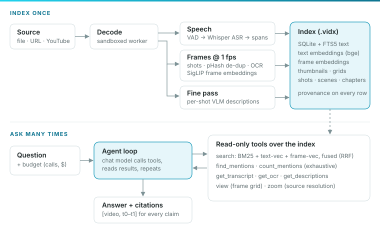
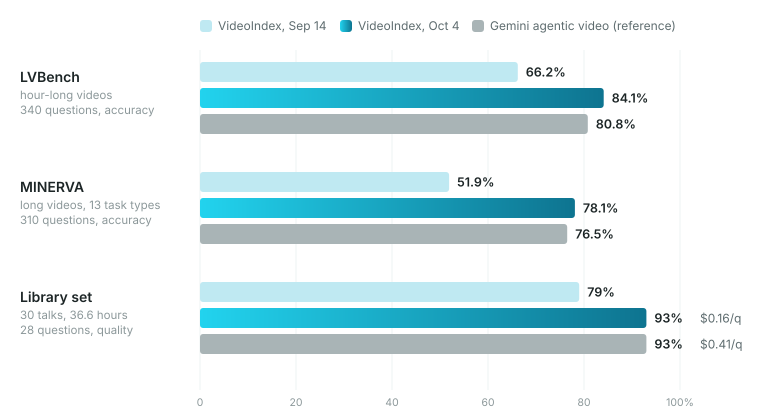

Ask a question about a one-hour lecture, a conference talk or a playlist of thirty talks, and get an answer back in a few seconds. Every claim comes with a citation, a video id and a time range, so a player can jump straight to that moment. That is what [VideoIndex](https://videoindex.org) does. This post covers how it is built, how we measure it, and what moved the numbers in three weeks of evaluation-driven work.

  
<b>84.1%</b>LVBench (hour-long video), up from 66.2%

  
<b>78.1%</b>MINERVA, up from 51.9%

  
<b>93%</b>library Q&amp;A quality at 2.6× lower cost than the reference

  
<b>6 / ~20</b>changes kept / experiments that measured no gain

The reference throughout is Gemini's agentic video mode reading the raw files, which scores 80.8% and 76.5% on the same samples. VideoIndex now beats it on both.

## Two ideas

**Index once, ask many times.** Watching a video with a large multimodal model every time someone asks a question is slow and expensive. VideoIndex does the expensive perception work once and stores what it finds: speech, on-screen text, what frames look like, shot boundaries, and short descriptions of what is visible. Questions are then answered by searching that store. Indexing an hour costs cents of GPU time, and a question costs a few cents of model calls.

**An agent that cites the moment.** A language model answers by calling **tools** over the index: search here, read the transcript there, look at these frames. Every factual claim must point at a stored fact with a time range. The model is not trusted to remember the video. It is made to look.

The engine is a Rust workspace (decode, perception, index, query, agent and server crates) with Python and Node bindings, a `vidx` CLI, and an HTTP server with SSE streaming and MCP. The [chat demo](https://videoindex.app) runs on the same SDK.

<figure>
  
  <figcaption>Two halves. Indexing runs once per video; the agent loop runs per question and only ever reads the index (and, for close looks, the media).</figcaption>
</figure>

## Indexing: from pixels and audio to searchable facts

Indexing is a graph of **operators**. Each is one processing step with typed inputs and outputs, a version and a cost estimate. A **policy** names which operators run. The scheduler builds the dependency graph from the declared inputs and outputs and runs the operators as concurrent tasks with bounded channels between them, so an hour of frames never sits in memory. Decoding runs libav in a sandboxed worker process, so a malformed file cannot take down the indexer. Frames cross into the main process through shared memory with a fixed number of slots, which also gives the pipeline its backpressure.

**Audio.** Subtitles are imported directly when the source has them. Otherwise Silero VAD finds the speech in one batched pass, and only speech goes to Whisper large-v3, so an hour of lecture with forty minutes of talking costs forty minutes of ASR. Word timings split the output into transcript spans a few seconds long.

**Video.** Frames are sampled at 1 fps. Shot boundaries come from an HSV-histogram distance plus an edge-change ratio with an adaptive threshold. A 64-bit perceptual hash collapses near-identical consecutive frames: a slide on screen for two minutes costs one embedding and one OCR pass, not 120. Distinct frames get a SigLIP embedding, which lives in the same space as text, so "slide with an architecture diagram" can match pixels directly. RapidOCR reads on-screen text: slides, code, scoreboards.

**Fine pass (optional, paid).** Scenes, chapters, entities, and, as of October, a **per-shot description** from a vision model. Each one uses a compact fixed schema (people, objects with counts, actions, on-screen text, a one-sentence summary) and costs about $0.003 per shot, or $0.45–0.82 per hour of video.

Every stored row carries **provenance**: which operator, model version and prompt hash produced it. Re-running a job plans each stage as *skip*, *replay* or *run*, so adding a fine pass to an existing index never touches the pixels again.

On a 30-video, 36.6-hour library, coarse indexing ran at about **7× real time** overall on a CPU ONNX build with Whisper on the GPU. Camera-heavy talks index at 20× or better. Slide decks that change every few seconds are the slow case, because OCR dominates.

## Retrieval: finding where to look

`search` runs three retrievers in parallel and fuses them:

1. **BM25** (SQLite FTS5) over transcript, OCR, descriptions and segment summaries.
2. **Text-vector** search over the same rows (bge embeddings, ~30 s windows with overlap).
3. **Frame-vector** search using SigLIP's text tower, so words match frames.

The three lists are combined with **reciprocal rank fusion**, score = Σ 1/(k + rank), then grouped into scenes. A moment where the transcript, the slide text and the description all agree outranks a lucky keyword match. Hits are capped per video, so a library-wide query spreads across talks instead of being filled by the one talk that says the word most.

Ranked retrieval is a *sample*, though. It can never prove that no other video mentions a term. For "which videos mention X", the index has a second path: an exhaustive FTS5 phrase scan grouped by video (`find_mentions`, `count_mentions`). It is deterministic and takes milliseconds.

## The agent loop

A question runs under a **budget**: tool calls, dollars, tokens and wall-clock time. The loop is a plain conversation:

1. The system prompt sets the rules (which tool for which question shape, cite everything, never invent) and lists the videos.
2. The model either answers or asks for one or more tool calls. Calls in the same turn run concurrently.
3. Results go back into the conversation. Repeat.
4. Citation markers such as `[[cite:VIDEO:T0-T1]]` are parsed out of the stream and emitted as typed citation events.

The tool-call cap is a hard limit. When it is reached, the tools are withheld and the model is told to answer from what it has seen and say what it could not check.

| Tool | What it does | Cost |
|---|---|---|
| `search` | hybrid retrieval, ranked hits with evidence snippets | ~2 s |
| `find_mentions`, `count_mentions` | exhaustive term scan, per video or aggregated | ms |
| `get_transcript`, `get_ocr`, `get_descriptions` | timed text for up to three windows already located | ms |
| `timeline` | chapters, scenes or shots with summaries | ms |
| `view` | decode a window into a labelled 16-frame grid plus its transcript | ~0.5 s + image tokens |
| `zoom` | one frame at source resolution, optionally an enlarged region | ~0.3 s + image tokens |

A worked example. *"Which speakers mention Kaggle, and what do they say?"*, asked over the 30-talk library. Turn 1: `find_mentions(["Kaggle"])` returns 2 of 30 videos and 8 hits in 4 ms. Turn 2: two transcript reads in parallel. Turn 3: the answer, citing five moments. That took three tool calls, 12.6 s and $0.086.

## How we measure

Evaluation decided every change, and most of the work was making the numbers readable.

- **LVBench** (hour-long videos) and **MINERVA** (long videos, 13 task types) are public multiple-choice benchmarks. We run fixed 25% stratified samples, 340 and 310 questions, at $16–33 per run.
- **The library set** is 28 of our own questions over 30 talks: which videos mention X, moments about a topic, cross-video comparisons, summaries, and one question nothing matches. A judge model turns each free-text answer into structure (videos named, timestamps, facts). Scoring is deterministic after that.
- **The reference** is Gemini agentic video over the raw files, run once and cached. The baselines are retrieval-only and 32 uniformly sampled frames.

> **Noise first.** Between two runs of the *same* agent, 37–47 of 310 MINERVA questions flip, which is about ±2 points. Almost every experiment moved the headline by less than that.

That forced four habits:

- **Paired diffs, not percentages.** For each comparison, count the questions fixed and the questions broken on the same question ids, and apply McNemar's exact test. The merge bar, written down before any run, is **fixed − broken ≥ +5 on 310 questions, plus a mechanism reason**.
- **Bands, not single baselines.** A subset's baseline is itself one draw, so we print its count under every comparable run and read a check against that band.
- **Split on the mechanism.** Models reach for new tools on hard questions, so "with the tool" always scores lower than "without". Read the paired diff on the rows where the tool was actually used.
- **One switch, one branch, one full run.** Small slices measure nothing: a 120-question slice showed zero gap between two agents that differ by two points overall.

## Results

<figure>
  
  <figcaption>Same questions, same videos, same scoring for every bar. The reference run is cached and re-scored on the same samples.</figcaption>
</figure>

| | LVBench | MINERVA | Library set |
|---|---|---|---|
| Sep 14 agent (Claude Sonnet 5, 6 tool calls) | 66.2% | 51.9% | 79% |
| Gemini agentic video (reference) | 80.8% | 76.5% | 93% @ $0.41/q |
| **Oct 4 agent** (Gemini 3.8 Flash, 20 calls, $0.30 cap) | **84.1%** @ $0.07/q, 17 s p50 | **78.1%** @ $0.11/q, 25 s p50 | **93%** @ $0.16/q |

On the single-video benchmarks the reference is slightly cheaper per question ($0.05–0.06). On library questions, the kind it was not built for, VideoIndex reaches the same quality at 2.6× lower cost and 1.6× lower median latency. Retrieval alone scores 48% on the library set; the agent adds the rest.

## What moved the needle

Six changes carried the gain, in the order they landed.

1. **Remove the cap the agent was hitting.** Half the questions ended at the 6-call cap and scored 40–60% there, against 90%+ for questions that finished on their own. Raising the cap to 12 calls took LVBench from 77% to 82% and MINERVA from 67% to 72%. The biggest single lever was a config value.
2. **Change the reader.** Gemini 3.8 Flash against Claude Sonnet 5, with the same tools on the same samples: +10 points on both benchmarks at a quarter of the cost. One flag, one run.
3. **Exhaustive tools for collection questions.** Library misses were almost all recall: the agent concluded "no other video mentions X" from a ranked sample. With `find_mentions` and `count_mentions`, plus a prompt rule routing those question shapes to them, quality went from 79% to 93% and recall to 100%.
4. **Tools that read where the model has already looked.** A redesign added multi-window forms (read six ranges in one call) and lost 3 points. Splitting the run files showed the model was using six-window text reads as a dragnet. Capping them at three windows of at least 4,000 characters, described as "read ranges you've already located", recovered the accuracy with 24% lower latency. **A tool's description is part of its behaviour.**
5. **A look at source resolution.** Analysing failures by cause put 38 of 99 MINERVA misses on fine detail: price tags, digits, signs, all unreadable in a 448 px grid tile. `zoom` returns one frame at full size with an optional enlarged region. MINERVA went from 72.9% to **78.4%** (24 fixed, 7 broken, p < 0.005) for +8% cost. It only worked together with a budget change: with the old 120k-token budget, the extra looks ran out of room.
6. **Text about what is visible, at index time.** Transcript and OCR cover what is said and written, never what is on screen. Per-shot descriptions added that text. On LVBench they moved three draws to 288, 294 and 286 correct, against 279–284 without them. On MINERVA's shorter videos, where the agent already looks at the right moment, they read flat.

## What did not

About twenty experiments missed the bar. Some of them:

- **More budget alone.** Stepping the unchanged agent up four budget levels read 72.6 / 72.9 / 73.2 / 72.9%. Past the first raise, the loop just takes more looks at the same pixels.
- **History compaction.** Replacing old frame grids with placeholders freed tokens, and the model spent them on more looks of the same kind.
- **A whole-video thumbnail grid** and **a native video clip with sound.** The grid was too coarse to answer anything by itself and ate the token budget. The clip helped audio questions (1 → 3 of 5) but missed the bar by one question, twice.
- **Denser looks at motion, five ways**, up to a loop-enforced 4 fps tally. "How many times did she pinch the yarn" stayed wrong with every frame in front of the model. This is a perception limit, and the reference misses 12 of the same 18 questions.
- **Prompt-line procedures.** "Call scan first", "count twice", "tally per piece": each was followed 40–60% of the time and read flat.
- **Exact instruments offered as new tools.** An OCR reader and an object detector were picked up on 3–4% of eligible questions. Attached to `zoom` results instead, they reached the model and changed nothing.
- **Escalating to a stronger model at the cap.** A Pro-class second pass from scratch discards the evidence the first pass bought, and runs out of budget on the same questions.

**The pattern.** This chat model follows procedures loosely, rarely picks up a tool it has to choose to call, and does not improve by looking harder at the same pixels. What worked did one of three things: removed a limit it was hitting, changed what it could *see*, or changed the model itself.

## Lessons

- **Find the binding constraint before building anything.** Ours was a config value, then a token budget, then pixel resolution.
- **Design levers as loop actions or as changes to what existing calls return**, not as new tools the model has to decide to call.
- **Reach is not movement.** A signal the model sees, such as audio tags, a stronger frame encoder, or shot text on short videos, often changes nothing. Measure the two separately.
- **Measure every change on every benchmark it touches.** A prompt line read +6 on MINERVA and −6 on LVBench, and was reverted the same night.
- **Record the arguments of every tool call in the run file.** Twice a hypothesis was untestable until a field was added, and splitting existing runs found both regressions without a rerun.

## What's next

The remaining MINERVA misses are mostly fine detail and repeated-action counting. The next lever there is probably a different signal, such as pose keypoints or frame-difference energy, rather than another look. The bigger thread is **live video**: indexing streams while they happen, answering with "now" in mind, and joining calls.

Try the demo at [videoindex.app](https://videoindex.app) or read more at [videoindex.org](https://videoindex.org).
